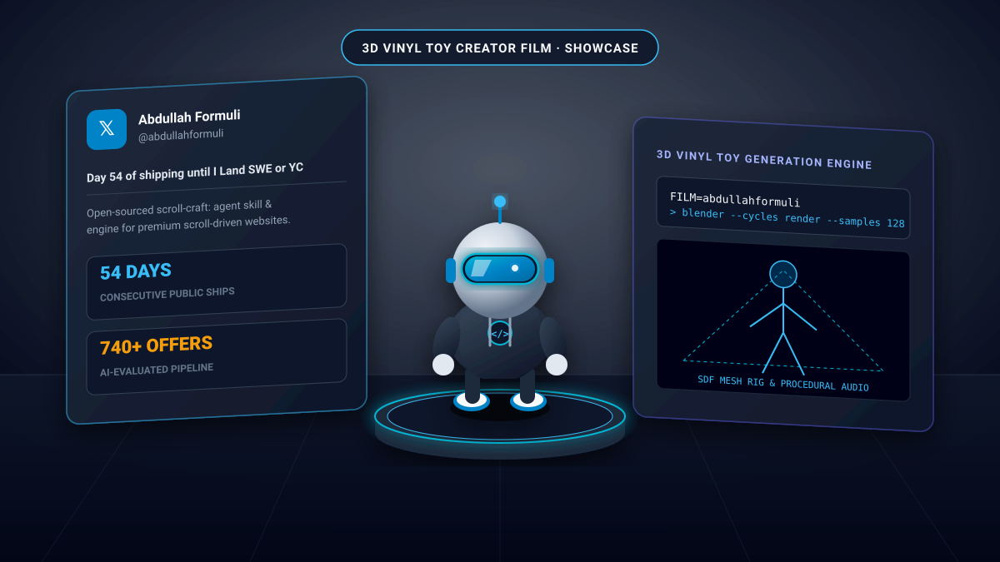

> ⚠️ **Experimental Codex & Claude Code support.** The video skill builds stylized 3D vinyl toy intro films from live creator material. Tested on macOS Apple Silicon and Linux with Blender Cycles.

<div align="center">

# ChrisHKAI-Video

**Paste a creator's X link, get a short film starring them as a 3D vinyl toy.**<br>
Their profile picture peels off the page and puffs into a toy of them; their best posts stand up as walls; their numbers rise out of the page.<br>
<sub>A video skill for coding agents, made entirely in code.</sub>

<a href="#how-to-use"></a> <a href="#feature-presentation"></a> <a href="#maintenance--governance"></a> <a href="#licence"></a>

<sub>Repository: [github.com/authrain-cloud-abdullahformuli/ChrisHKAI-Video](https://github.com/authrain-cloud-abdullahformuli/ChrisHKAI-Video) · Maintained by [Abdullah Formuli](https://github.com/authrain-cloud-abdullahformuli) ([@abdullahformuli](https://x.com/abdullahformuli))</sub>

</div>

---

## 🎬 Feature presentation

<div align="center">



### **▶ Abdullah Formuli** · [@abdullahformuli](https://x.com/abdullahformuli) · 0:30
<sub>The avatar peels off the X profile page and pops into a 3D vinyl engineer toy; monolithic posts stand up as dimensional walls across 55+ daily shipping milestones, and verified analytics rise directly out of the timeline floor.</sub>

<br>

All films are code from the first frame to the last note: Blender Cycles renders the picture, Python synthesizes the sound.<br>
[**Worked Example Walkthrough**](examples/README.md) · [**Skill Specification**](skills/creator-toy-intro/SKILL.md)

</div>

---

## 👋 Overview

Maintained and built by **Abdullah Formuli** ([@abdullahformuli](https://x.com/abdullahformuli)).

> **Not a template pack.** Every film is generated by a coding agent driving Blender and procedural audio scripts in code.

Every film is directed, built, scored, and rendered by an agent writing code:

- 🧸 **Toy**: Built from a parts list, a pet kit, or a signed distance field (SDF) sculpt, confirmed via turnarounds.
- 🎨 **Picture**: The profile page is rendered in HTML; the 3D scene is staged in Blender Cycles and rendered frame-by-frame.
- 🎵 **Sound**: Procedurally synthesized in Python or played through high-quality sampled acoustic/synth instruments cut to the film's beat grid.

No black-box video generation models, no generic stock footage. The creator's actual posts, timestamps, metrics, and profile aesthetics are the ground truth.

---

## How to use

Choose your agent: [Codex](#codex-desktop-or-cli) or [Claude Code](#claude-code). Both share the same engine and Blender rendering pipeline.

### Codex (desktop or CLI)

Clone the repository and install the complete skill:

```sh
git clone --depth 1 https://github.com/authrain-cloud-abdullahformuli/ChrisHKAI-Video.git
cd ChrisHKAI-Video
python3 scripts/install-codex.py
```

On macOS/Linux this links the skill into `~/.agents/skills/creator-toy-intro`.

Open Codex in a writable film folder, then prompt:

```text
$creator-toy-intro Make a self-intro film for https://x.com/abdullahformuli
```

### Claude Code

Install the skill as a plugin:

```sh
claude plugin marketplace add https://github.com/authrain-cloud-abdullahformuli/ChrisHKAI-Video.git
claude plugin install chrishkai-video@chrishkai-video
```

Or run directly from checkout:

```sh
git clone https://github.com/authrain-cloud-abdullahformuli/ChrisHKAI-Video.git
mkdir my-films && cd my-films
claude --plugin-dir ../ChrisHKAI-Video
```

Then prompt your agent:

```text
Make a self-intro film for https://x.com/abdullahformuli
```

---

### What happens

Six stages, each producing visual feedback for sign-off:

| Step | What it does | Visual Checkpoint |
|---|---|---|
| **0 · Preflight** | Checks Blender 5.2+, Node 22+, Python 3.9+, ffmpeg and Chrome | Preflight diagnostic report |
| **1 · Link Intake** | Reads the profile link and initializes the film workspace | Choose 16:9 (Desktop) or 9:16 (Mobile) |
| **2 · Story Extraction** | Analyzes milestone posts, follower growth, and core achievements | Story direction options with live previews |
| **3 · Toy Assembly** | Builds the 3D vinyl toy mascot with custom materials and joints | Turnaround preview on the dark studio stage |
| **4 · Storyboard** | Arranges film acts, beat grids, camera moves, and audio beds | Storyboard frame review & audio listen pass |
| **5 · Cycles Render** | Executes test frames, then renders full 30 fps Cycles master | Finished MP4 with stems and social covers |

---

### The Sound System

Preview procedural audio layers under the animatic with `run.mjs listen`:

| Sound Option | Description |
|---|---|
| `bed` (default) | Cinematic sound effects over procedural synth chords |
| `song` | Full synthesized multi-track electronic theme |
| `band` | Arrangement rendered via acoustic sampled instruments |
| `strings` | Warm orchestral string quartet and grand piano |
| `fx` | Impact and mechanical effects alone |

---

## Prerequisites

- **Blender 5.2+** (with Cycles GPU acceleration recommended)
- **Node.js 22+**
- **Python 3.9+** (with NumPy and Pillow)
- **ffmpeg** (for video encoding and audio multiplexing)
- **Headless Chrome** (for profile card DOM rendering)

---

## 🛡️ Maintenance & Governance

This repository is maintained solely by [Abdullah Formuli](https://github.com/authrain-cloud-abdullahformuli). External contributions or third-party pull requests are not accepted.

---

## Licence

MIT License. See [LICENSE](LICENSE).

Copyright (c) 2026 Abdullah Formuli.

---

<div align="center">

⭐ **Star this repo to support development**<br>
𝕏 Follow [@abdullahformuli](https://x.com/abdullahformuli)

<sub>ChrisHKAI-Video · Maintained by Abdullah Formuli</sub>

</div>
